# Mossgrove for iOS: an NthCase sample app

Mossgrove is a small, fictional shop for home and desk goods. It is built to be tested with
[NthCase](https://nthcase.com), the AI testing platform that records and replays tests on Android, iOS and the web.
Clone it, build it, and run your first NthCase test on it in minutes.

It is one of five identical Mossgrove apps. The same screens, test ids, texts and scenarios are built in Kotlin +
Jetpack Compose, SwiftUI (this one), Flutter, React Native and Ionic, all from one spec: [SPEC.md](SPEC.md),
**spec 1.0**. Every verb NthCase supports has a place to land, and so do the hard cases real apps have: a slow screen,
a failed load with retry, a web view, a system permission prompt, a modal, and a screen with no test ids at all.

- No network, no analytics, no ads, no tracking, no third-party code. Everything is seeded inside the app, so every
  run is the same.
- One screen, Settings, is built with **UIKit** (a `UITableView` in a `UIViewController`), so both iOS UI toolkits are
  covered. The rest is SwiftUI.

| Sign in | Shop | Item | Cart |
| --- | --- | --- | --- |
| 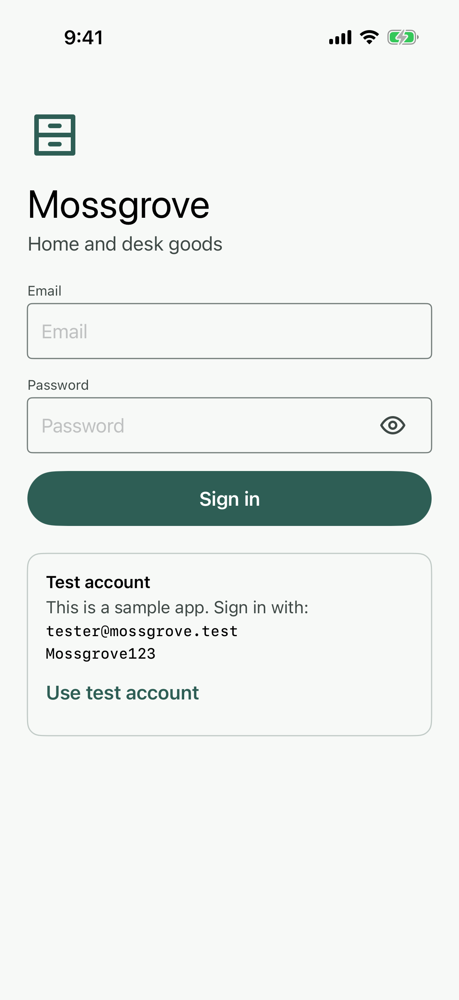 | 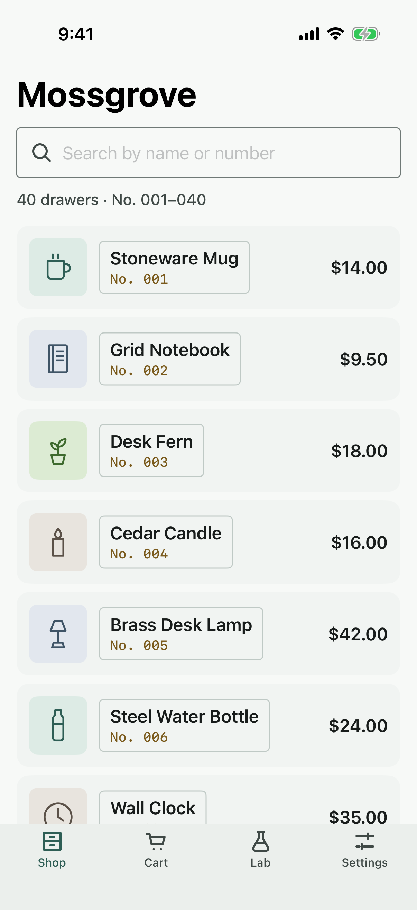 | 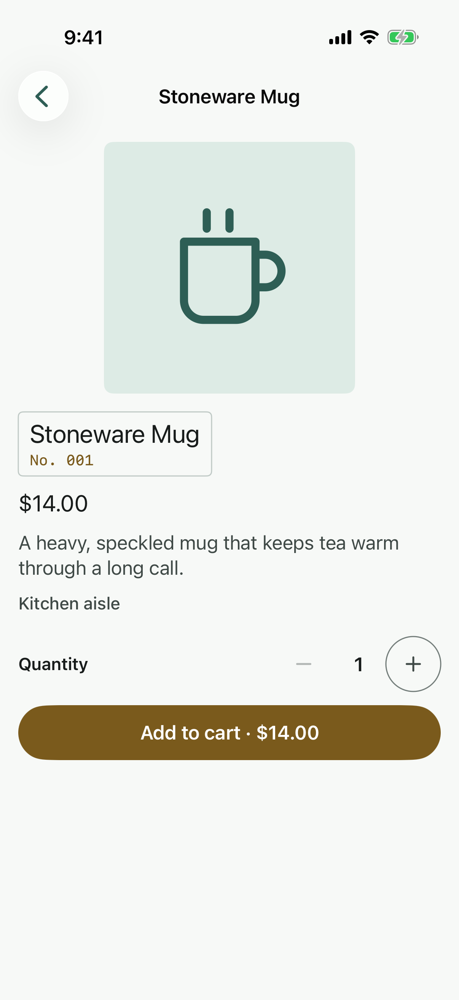 | 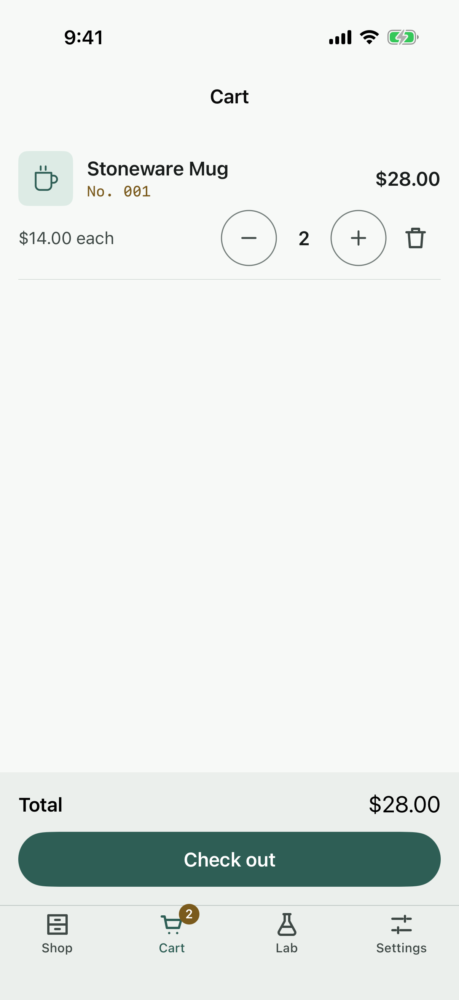 |
| Modal | Lab | Form errors | Form done |
| 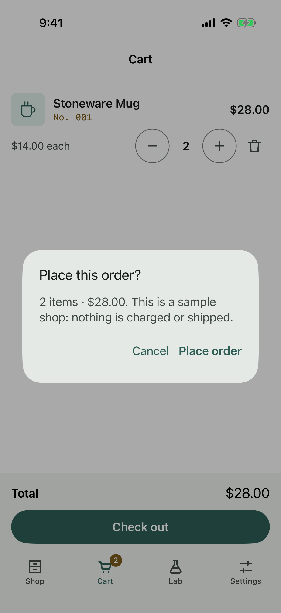 | 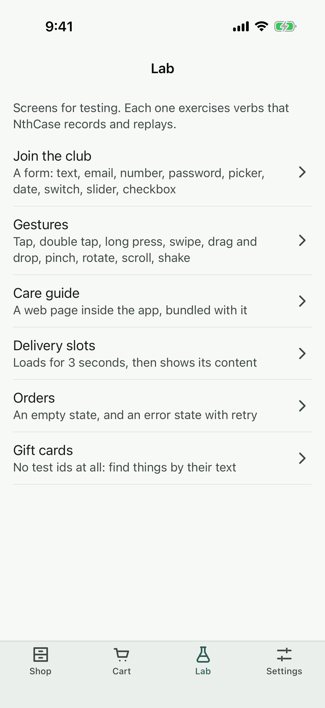 | 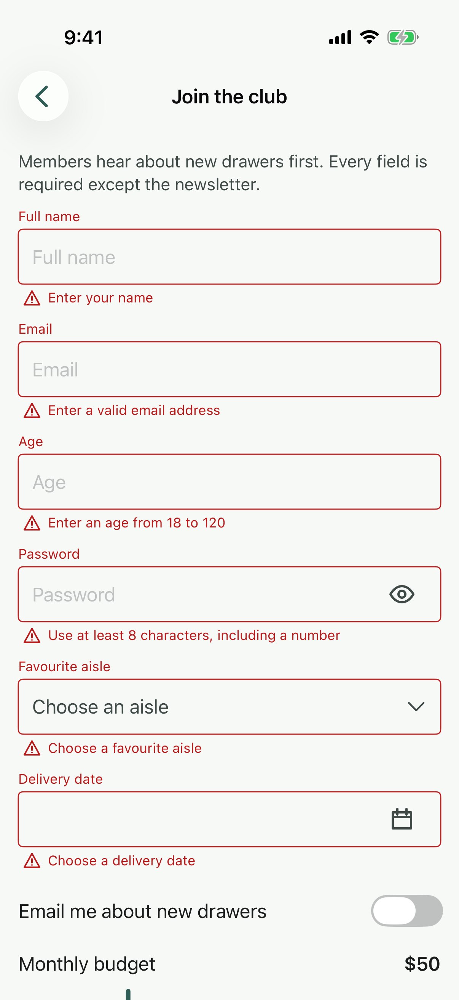 | 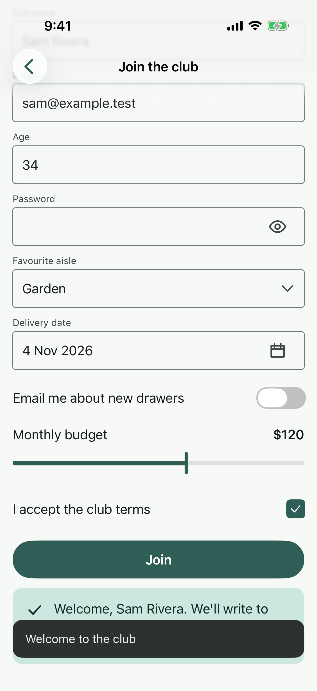 |
| Gestures | Delivery slots | Error + retry | No test ids |
| 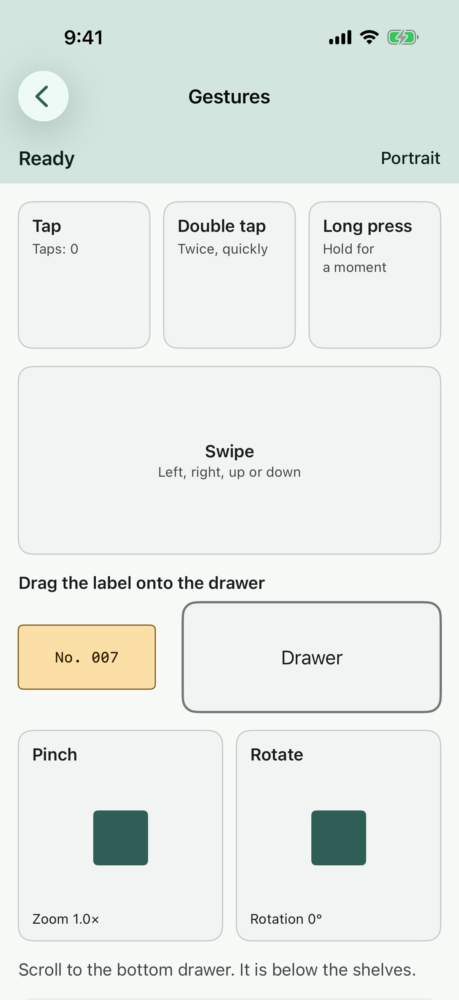 | 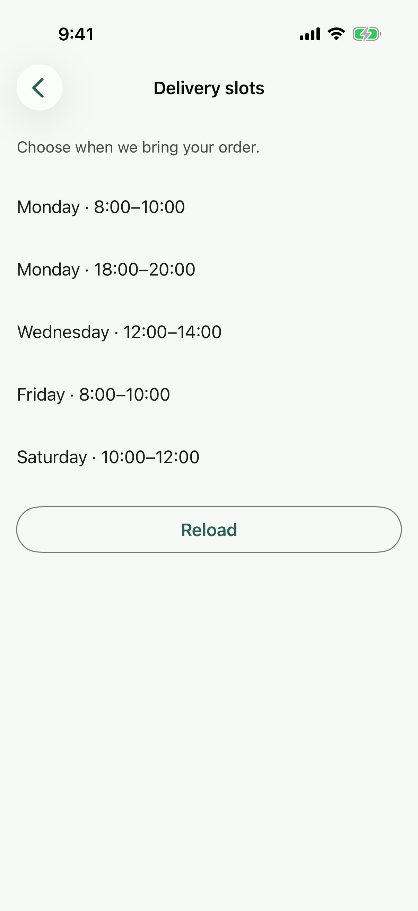 | 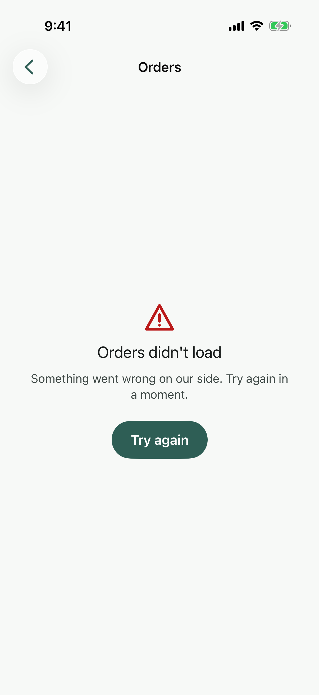 | 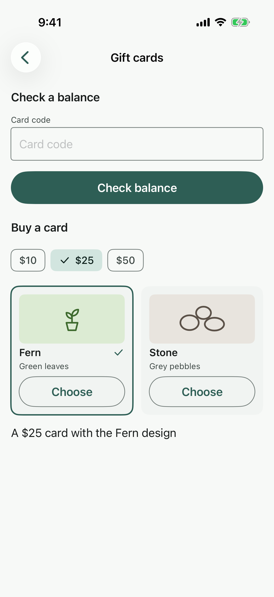 |
| Settings (UIKit) | UIKit alert | Care guide (web view) | Deep link, unknown id |
| 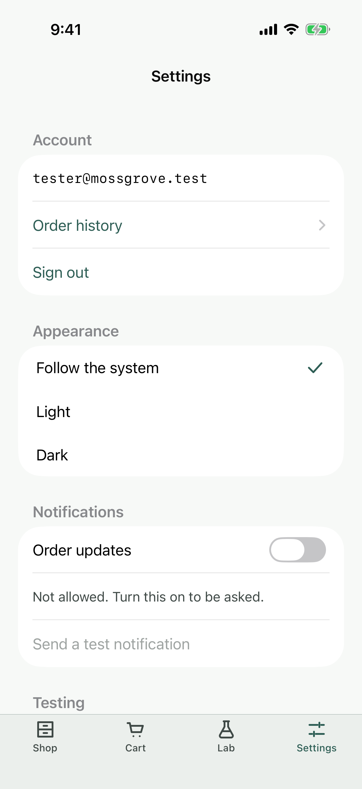 | 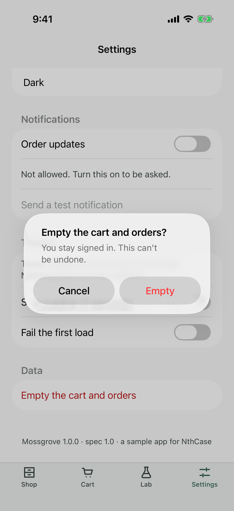 | 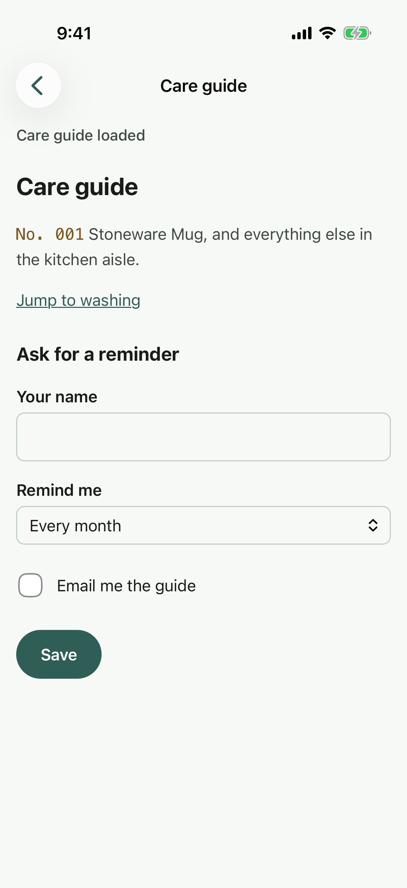 | 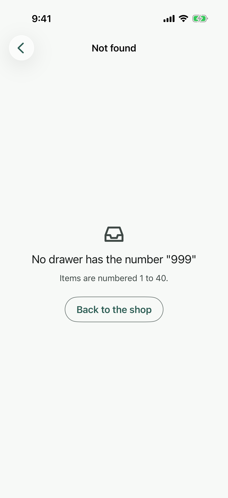 |

All 24 screens, light and dark, are in [docs/screenshots](docs/screenshots). The XCUITest suite takes them on a CI
simulator.

## Test account

| | |
| --- | --- |
| Email | `tester@mossgrove.test` |
| Password | `Mossgrove123` |
| Gift-card code | `MOSS-0025` |
| Deep link | `nthcase-sample://item/{1–40}` |
| Bundle id | `com.nthcase.sample` |

The account is printed on the sign-in screen too, with a **Use test account** button.

## Get the app

Every [release](../../releases) has `mossgrove-ios-<tag>-simulator.zip`: the app built for the iOS Simulator (Apple
silicon and Intel), with `SHA256SUMS` beside it. It runs on iOS 17 or later. Unzip it, and install it on a simulator
you name by its UDID (`xcrun simctl list devices` lists them):

```bash
unzip mossgrove-ios-v1.0.0-simulator.zip
xcrun simctl install <udid> Mossgrove.app
```

There is no `.ipa`: a build for a real iPhone needs your own signing team. Open the project in Xcode, set a team under
Signing & Capabilities, and run it on your phone.

## Build

You need a Mac with Xcode 26 or later (it builds against the iOS 26 SDK; the app runs on iOS 17 and later). Nothing
else: no CocoaPods, no package to fetch.

```bash
xcodebuild build -project Mossgrove.xcodeproj -scheme Mossgrove -destination 'generic/platform=iOS Simulator' -derivedDataPath build/DerivedData
```

```bash
scripts/package-simulator-app.sh v1.0.0
```

That builds Release for arm64 and x86_64, zips `Mossgrove.app` into `dist/`, writes `SHA256SUMS`, and checks the zip's
bundle id, minimum iOS and URL scheme.

## Tests

```bash
swift test --package-path MossgroveKit
```

Runs on the Mac, with no simulator. The app's logic lives in `MossgroveKit`, a local Swift package: the catalogue, the
cart, the form's rules, deep-link parsing, the gesture and shake rules, navigation, how a hidden password takes a key.
Its tests also check the repository:
the catalogue against SPEC.md's table, the asset catalog against `art/`, and a **source census** that every id in
`nthcase/test-ids.json` is used on its own screen's source file and nowhere else, with no id outside the list. A
second census checks what CI depends on: every text field is focused by a tap anywhere in its box, a password is one
field whose dots come and go in place, the tab bar is the app's own buttons, every list's id is on a container around
its scroll view and every screen's root is a node of its own, the banner sits above the Cart's Check out, the budget is
a slider whose thumb sits where XCUITest presses and whose value follows the finger alone, the form puts the keyboard
away when a person moves on and asks iOS to save no password, the UI tests open a link the way the system does, wait
for what they tap and name what covers it, the id walk names every id, the UI tests name no id outside the list, and
the `build` workflow runs and reports every check even after one fails.

`scripts/ax-shapes.swift` shows, on the Mac, the accessibility tree SwiftUI builds for the screens' shapes, and fails
if a shape the app uses loses an id:

```bash
swiftc -O scripts/ax-shapes.swift -o build/ax-shapes && build/ax-shapes
```

`scripts/slider-replay.sh` runs the app's budget slider in a Mac Catalyst process, with UIKit's own slider and
accessibility code, and plays XCUITest's slider drag through it: it fails if any of 441 slides (every start, every
step) misses its step.

```bash
scripts/slider-replay.sh
```

On a simulator (CI runs these on one it creates for the run):

```bash
xcodebuild test -project Mossgrove.xcodeproj -scheme Mossgrove -destination 'id=<udid>' -derivedDataPath build/DerivedData
```

| Target | What it proves |
| --- | --- |
| `MossgroveTests` | the app's model, the UIKit screen's ids, the alert's button ids, the shake |
| `MossgroveUITests/IdWalkTests` | every screen in the state the spec names, with every id of `test-ids.json` in XCUITest's tree, which is the tree Appium reads; Gift cards has none; each `nav_*` id is the button a person taps (CI runs this one on an older iOS too, when the runner has one) |
| `MossgroveUITests/FlowTests` | the flows of scenarios 01–11, typed as NthCase types (no Return unless the scenario says so); the deep link from a cold start, and to the running app signed in and signed out; a tab opens at its first screen; the edge swipe goes back |
| `MossgroveUITests/ScreenshotTests` | every screen, light and dark |

| | |
| --- | --- |
| UI | SwiftUI: the app's own tab bar over a `NavigationStack` per tab (not `TabView`, see Test ids); Settings in UIKit (`UITableView`, `UIAlertController`) |
| Minimum iOS | 17.0 |
| Web view | `WKWebView` with the bundled `care-guide.html`; http(s) is blocked |
| Permission | notifications only (`UNUserNotificationCenter`), asked from Settings |
| Deep link | `CFBundleURLTypes`, scheme `nthcase-sample` |
| Shake | `motionEnded(.motionShake)`, and the spec's three jolts on the accelerometer |

### Dependencies

| Ships in the app | Publisher |
| --- | --- |
| SwiftUI, UIKit, WebKit, UserNotifications, CoreMotion, Foundation | Apple (the iOS SDK) |
| `MossgroveKit` | this repository |

| Build and test only (never in the app) | Publisher |
| --- | --- |
| Xcode, `xcodebuild`, XCTest, XCUITest, `swift test` | Apple |
| GitHub Actions: `actions/checkout`, `actions/upload-artifact`, `actions/download-artifact` (pinned to commits) | GitHub |

No Swift package from anyone else, no CocoaPods, no Carthage.

## Test it with NthCase

1. Install the app on a simulator (above) or, built with your team, on a test iPhone.
2. Connect the device to NthCase with the agent: `npx nthcase-agent@latest`. The NthCase docs, under *Your
   devices*, walk through it. Or use a cloud device.
3. In NthCase, add an iOS app with the bundle id `com.nthcase.sample`, and upload the simulator zip as its build.
4. Create a scenario from one of the files in [nthcase/scenarios](nthcase/scenarios): its numbered lines are the
   steps, and each `Expect:` line is that step's check. Or record one: **Scenarios → New scenario → Record**.
5. Compile it, and run it.

With NthCase's MCP server, ask your assistant to "create a scenario from nthcase/scenarios/03-cart-and-order.md for
Mossgrove and run it on my iPhone simulator".

## What it covers

| NthCase verb | Where | Scenario |
| --- | --- | --- |
| launch, tap, type | sign in, search, every button | 01, 02 |
| scroll to an element, swipe | the 40-item list; the form; the gestures screen | 02, 04, 05 |
| doubletap, longpress, pinch, dragdrop | Lab › Gestures | 05 |
| slide, select | Lab › Join the club (slider, dropdown, date picker) | 04 |
| rotate, lock, unlock, home, back | any screen | 06 |
| shake | Lab › Gestures ("Shaken"; the Simulator's Device › Shake does it) | 06 |
| a web view | Lab › Care guide (a bundled page) | 07 |
| waitFor, an error with retry, empty states | Lab › Delivery slots, Lab › Orders, Settings › Testing | 08 |
| a system permission prompt, a modal, UIKit | Settings | 09 |
| a screen with no test ids | Lab › Gift cards | 10 |
| extract, startif / endif | the cart total; sign in only if asked | 03, 06 |
| deep link | `nthcase-sample://item/7` | 11 |

The full table, with every check type and the known gaps, is in [SPEC.md §8](SPEC.md#8-verb-coverage).

## Test ids

Every control has a stable test id from one list shared by all five apps: [nthcase/test-ids.json](nthcase/test-ids.json).
In SwiftUI they are `.accessibilityIdentifier`, in UIKit `accessibilityIdentifier`, so Appium finds them as the
element's `name` (the `accessibility id` locator). Three needed care, and the id walk proves each:

- **The tab bar.** It is the app's own: four SwiftUI buttons, each with its `nav_*` id. SPEC.md §12 names a `TabView`,
  but SwiftUI gives a tab item no identifier, and on iOS 26 the system bar's buttons do not take one from their
  `UITabBarItem` either (the second CI run found no `nav_*` id in the tree). The bar is on the four tabs' first screens
  only, as on Android, and the keyboard covers it, as it covers a system bar.
- **Lists and screens.** A list's id (`shop_list`, `cart_list`, `orders_list`, `slow_content`) is on a container
  around its scroll view, and a screen's root is `.screen(id)`: a container with a second child that draws nothing.
  SwiftUI folds a container whose only child is another container into one node, and the outer id wins, so on Orders
  and Delivery slots, which hold nothing but their list, the list's id was in no tree (second and third CI runs).
  `scripts/ax-shapes.swift` shows it.
- **Passwords.** Each password is one UIKit field whose dots come and go in place with Show password, so it keeps its
  focus, and it keeps what was typed when a new editing session begins (UIKit would empty a secure field).
- **Containers.** A screen root or a card is `.accessibilityElement(children: .contain)`, so its children keep their own
  ids. `.combine` is used only where nothing inside has an id (a shop row, an order row).
- **The budget slider.** UIKit's slider, so Appium and XCUITest read a slider, its value and its scrubbers. NthCase's
  `slide` sets a slider through XCUITest's `adjust(toNormalizedSliderPosition:)`, which presses 7.25 points inside the
  ends of the track and lifts at speed. Its thumb is a bar 14.5 points wide, as Material's slider on Android has a
  bar, so the thumb's centre is where XCUITest presses, and the app tracks the finger itself, so the value is the step
  under the finger and nothing moves after it lifts. With UIKit's 37-point thumb and its own tracking, 0.6 gave $130
  (third and fourth CI runs).
- **The form and the keyboard.** Choosing an aisle, a date, the newsletter, the slider or the terms puts the keyboard
  away. The newsletter's whole row is its switch, as the terms row is its checkbox. The club's password is not offered
  to Passwords: iOS's "Save Password?" card lay over the Lab after the filled form was left (fourth CI run).
- **The banner.** It sits above the Cart's total and Check out, never over them, so Check out takes its tap while the
  banner's 10 s run.
- **The alerts.** The checkout dialog is the app's own view, because a SwiftUI alert's buttons cannot carry ids. The
  UIKit screen's `UIAlertController` gets its two button ids once it is on screen.

The care-guide page's elements have the same HTML `id` and `data-testid`; Appium sees them in the WEBVIEW context of a
Debug build. The Gift cards screen has none, on purpose.

## Layout

```
Mossgrove/App/              the app, the model, the tabs, the palette, notifications
Mossgrove/Components/       top bar, snackbar banner, dialog, shared views
Mossgrove/Screens/          the SwiftUI screens
Mossgrove/Settings/         the UIKit screen
Mossgrove/Resources/        Assets.xcassets (made from art/), care-guide.html
MossgroveKit/               the logic and its tests (swift test)
MossgroveTests/             unit tests inside the app
MossgroveUITests/           the id walk, the scenario flows, the screenshots
Config/Info.plist           the URL scheme
scripts/                    make-assets.swift, package-simulator-app.sh, ci-simulator.sh, ci-screenshots.sh,
                            ci-test-summary.py, ax-shapes.swift, slider-replay.sh and .swift
art/  nthcase/  docs/screenshots/
```

`swift scripts/make-assets.swift` turns `art/` into the asset catalog: the drawings are copied unchanged and kept as
vectors, and the launcher mark becomes the app icon. `art/` itself is never changed.

## CI

A push to `main` or a pull request runs the fast checks on `macos-latest`: `swift test` and the zipped simulator app,
in about 4 minutes, with no simulator. A push that changes only `README.md`, `CONTRIBUTING.md`, `SECURITY.md`,
`LICENSE`, `NOTICE` or `docs/screenshots/` starts nothing. The device suite runs on a simulator made for the run (the
screenshots, `MossgroveTests`, the id walk, the flows and the tabs on an older iOS, about 50 minutes) on "Run
workflow", at 03:17 UTC on the 1st of each month, and before every release: a `v*` tag publishes only when the fast checks and the
suite are green. To start the suite by hand, open Actions → build → Run workflow on `main`, or run
`gh workflow run build.yml --ref main`. The jobs are in [.github/workflows/ci.yml](.github/workflows/ci.yml).

## Licence

Apache-2.0, see [LICENSE](LICENSE) and [NOTICE](NOTICE). Mossgrove, its items and its drawings are fictional and were
made for these apps. "NthCase" is a trademark of Unidots Software Solutions LLC.
